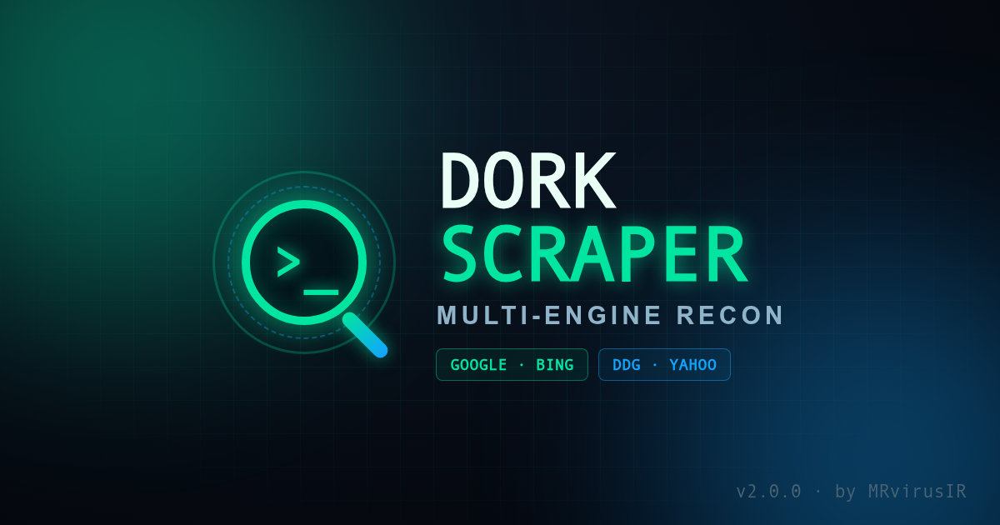

<p align="center">
  
</p>

<h1 align="center">
   Dork-Scraper
</h1>

<p align="center">
  <b>A local recon workspace and multi-engine URL scraper for authorized security research.</b><br>
  Search Google, Bing, DuckDuckGo, Yahoo, Brave &amp; Google via SerpApi — then clean, filter and export results.
</p>

<p align="center">
  
  
  
  
  <a href="https://t.me/BugCod3"></a>
</p>

---

## ✨ What's new in 3.0

- **Local web workspace** — responsive search, URL cleaner, dark/light theme, and local history.
- **Multi-engine searches** — run multiple queries across selected engines, combine results, track their source, and export TXT, JSON or CSV.
- **API providers** — Brave Search API and Google results via the third-party SerpApi service, using your own API keys.
- **URL Cleaner** — paste or import a list, preview cleaned URLs alongside their first original, and export; no target URLs are contacted.
- **Local jobs** — per-engine status and errors, progress, cancellation and SQLite history.
- **Safer validation** — rejects invalid URL schemes, invalid ports and URLs containing credentials.
- **CLI remains available** — existing workflows and text, CSV and JSON exports continue to work.

> See [CHANGELOG.md](CHANGELOG.md) for details and limitations.

---

## 🖥️ Local workspace

```bash
git clone https://github.com/MRvirusIR/Dork-Scraper.git
cd Dork-Scraper
python -m pip install ".[web]"
dork-scraper-web
# Open http://127.0.0.1:8765 in your browser
# Optional: dork-scraper-web --port 8080
```

Choose **Search** for single or batch searches, **URL Cleaner** for local list processing, or **History** to reopen saved jobs. Search results are grouped across engines using the selected deduplication mode and retain the engine/query sources. Downloads contain the full result set, not just the current text filter. Include-domain supports comma-separated globs (for example `example.com, *.example.com`). Search jobs run sequentially with a configurable delay; stopping a job waits for the current query/engine search to finish. The history screen shows the latest 100 jobs and supports deletion.

### Query scope and engine behavior

Enter **one dork per line**. If you paste a list of inline-code dorks separated by `and` or commas, the workspace separates them; a plain Boolean expression is not silently split. For one unambiguous positive `site:example.com` operator, the scope guard only keeps that domain and its subdomains. `site:*.example.com` keeps subdomains **only**, not the apex. The wildcard may be sent to the provider as `site:example.com` for compatibility; the actual submitted query and the number of excluded URLs are shown in the result status. Domain filters compare actual hostnames (ports ignored); `*.example.com` does not include the apex.

Search engines may ignore dork operators or relax query matching. The scope guard checks **hostnames only** and does not prove authorization. As an additional narrow check, a single simple `inurl:"?key="` is enforced as the exact, case-sensitive URL substring `?key=`; other `inurl:` forms and search operators are not verified locally. For OR, NOT, multiple site operators or unsupported site syntax, the automatic site guard is inactive and a warning is shown; use explicit Include domains or separate queries. Old saved search results are filtered on display under the same rules. Search engine CAPTCHA and JavaScript challenges are upstream limitations: this tool reports them and does not solve or bypass them. Google Selenium is available in the CLI with `pip install ".[selenium]"` and `--selenium`, but it is not guaranteed to prevent challenges and is not currently a web-panel option.

The workspace binds **only to 127.0.0.1**, has no user accounts, and is intended for one trusted local user, not a public or multi-user deployment. Keep your computer account private: search queries and results are stored unencrypted in `~/.dork-scraper/workspace.sqlite3`. You can set `DORK_SCRAPER_DB` before launch to choose another location. The UI's theme preference is stored in the browser. The server applies host/origin checks and a per-process token to mutation requests; these are not a substitute for authentication on a shared machine.

### Brave Search

Brave requires a [Brave Search API subscription and key](https://api-dashboard.search.brave.com/api-reference/web/search/get); provider fees or quotas may apply. Configure the key **in the server environment**, not in a URL or saved workspace:

```bash
export BRAVE_API_KEY="your-api-key"  # PowerShell: $env:BRAVE_API_KEY="your-api-key"
dork-scraper-web
# Also works with the CLI:
dork-scraper -e brave -d 'site:example.com'
```

Brave's API supports up to 10 pages and 20 results per page. Search engines may change HTML or return blocks/CAPTCHAs; the workspace reports per-engine errors, but cannot guarantee availability or completeness. No CAPTCHA bypass is provided.

### Troubleshooting provider results

- Start with `site:example.com` to include the apex and subdomains; `site:*.example.com` keeps **only subdomains**. Then add filters one at a time. A single `inurl:"?name="` is enforced as a literal URL substring, not as `&name=`. Indexed results can be incomplete or absent.
- CAPTCHA, HTTP 403/429, JavaScript-only Google pages and Yahoo HTTP 500 are provider-side responses, not evidence the target has no pages. The panel stops requesting a blocked provider or JavaScript-only Google for the rest of that job and shows skipped searches explicitly; try later or choose another provider. It does not bypass challenges.
- SerpApi may report a successful empty Google search in an `error` field; this is treated as zero results. Actual HTTP failures display a sanitized category without exposing the API key. Check your account, quota and provider status when needed.

### Google via SerpApi (optional third party)

The HTML Google provider may return a JavaScript-only page. As an alternative, select **Google via SerpApi** in the panel, or use `-e serpapi_google` in the CLI. This is a third-party service, **not an official Google API**. It needs a [SerpApi account and API key](https://serpapi.com/manage-api-key) and may use a paid plan; check [current quotas and prices](https://serpapi.com/pricing). Queries and result data are sent to SerpApi and may be retained by the service; review its terms and privacy policy. Do not paste your API key into the UI, a dork or an output file.

```bash
export SERPAPI_API_KEY="your-api-key"  # PowerShell: $env:SERPAPI_API_KEY="your-api-key"
dork-scraper-web
# Or: dork-scraper -e serpapi_google -d 'site:example.com'
```

Set the environment variable **before starting** the process, and restart the panel after changing it. SerpApi authenticates by a URL query parameter over HTTPS; the application avoids displaying or persisting that URL and suppresses credential-bearing request errors. Search requests can use your quota; the tool does not automatically retry SerpApi searches. A valid key and provider availability are still required; no results does not establish that matching pages do not exist.


---

## 📦 Installation

```bash
git clone https://github.com/MRvirusIR/Dork-Scraper.git
cd Dork-Scraper
pip3 install -r requirements.txt
```

Or install as a command-line tool (adds the `dork-scraper` command):

```bash
pip3 install .
# with the optional Selenium engine:
pip3 install ".[selenium]"
```

---

## 🚀 Usage

```bash
# simplest: one dork, save to urls.txt
dork-scraper -d 'inurl:index.php?id='

# equivalent without installing:
python3 -m dorkscraper -d 'inurl:index.php?id='
```

### Common examples

```bash
# 3 pages from Google, JSON output
dork-scraper -d 'inurl:index.php?id=' -e google -p 3 -f json -o results.json

# run a whole list of dorks, keep only URLs with parameters, dedupe by pattern
dork-scraper -D dorks/sqli.txt --params-only --unique pattern -o targets.txt

# DuckDuckGo, limit to one target domain (provider may still return a CAPTCHA)
dork-scraper -d 'site:example.com login' -e duckduckgo --include-domain '*.example.com'

# route everything through Burp / a proxy
dork-scraper -d 'ext:env DB_PASSWORD' --proxy http://127.0.0.1:8080

# use a real Chrome browser when an engine blocks HTTP requests
dork-scraper -d 'inurl:admin' --selenium

# clean an existing URL list (replaces the old split.py + clean-urls.py)
dork-scraper --clean-file old_urls.txt --drop-static --unique domain -o clean.txt
```

---

## ⚙️ Options

| Flag | Description |
|------|-------------|
| `-d, --dork` | A dork query (repeatable) |
| `-D, --dork-file` | File with one dork per line (`#` = comment) |
| `-e, --engine` | `google` \| `bing` \| `duckduckgo` \| `yahoo` \| `brave` \| `serpapi_google` (default `google`) |
| `-p, --pages` | Result pages per dork (default `1`) |
| `-o, --output` | Output file (default `urls.txt`) |
| `-f, --format` | `txt` \| `json` \| `csv` |
| `--unique` | De-dupe mode: `exact` \| `domain` \| `pattern` \| `none` |
| `--params-only` | Keep only URLs with query parameters |
| `--drop-static` | Drop images / css / fonts / media |
| `--trailing-slash` | Append `/` to param-less paths |
| `--keep-tracking` | Keep `utm_*` / `gclid` / … tracking params |
| `--include-domain` / `--exclude-domain` | Domain glob filters (repeatable) |
| `--clean-file` | Clean an existing URL file without scraping |
| `--delay` / `--jitter` | Base + random delay between requests |
| `--timeout` / `--retries` | Request timeout & retry count |
| `--proxy` | Proxy URL, e.g. `http://127.0.0.1:8080`, `socks5://…` |
| `--selenium` / `--no-headless` | Use a real Chrome browser |
| `-q, --quiet` / `--no-banner` | Quieter output |

Run `dork-scraper -h` for the complete list.

### `--unique` modes

| Mode | Keeps |
|------|-------|
| `exact` | Every distinct URL (default) |
| `domain` | One URL per domain |
| `pattern` | One URL per `host + path + parameter-names` — ideal for SQLi/XSS target lists |
| `none` | No de-duplication |

---

## 📁 Included dork lists

Ready-to-use starter lists live in [`dorks/`](dorks):

- `sqli.txt` — common parameterised endpoints
- `exposed-files.txt` — leaked config / backup / log files
- `admin-panels.txt` — login & admin panels

```bash
dork-scraper -D dorks/exposed-files.txt -e bing -f csv -o findings.csv
```

---

## 🐍 Use as a library

```python
from dorkscraper import DorkScraper

with DorkScraper(engine="duckduckgo", pages=2, clean_opts={"params_only": True}) as s:
    result = s.scrape("inurl:index.php?id=")
    print(result.count, "URLs")
    for url in result.urls:
        print(url)
```

---

## 🤝 Contributing

Issues and PRs are welcome. Run the tests with:

```bash
pip install -e ".[dev]"
pytest -q
```

---

## ⚠️ Disclaimer

This tool is intended **only** for legal, authorised security testing, research and
educational purposes. You are solely responsible for how you use it. Scrape responsibly,
respect each search engine's Terms of Service and `robots.txt`, and only test systems you
have explicit permission to assess. The author assumes no liability for misuse.

---

## 📜 License

Released under the [MIT License](LICENSE).

## 💜 Donate / Contact

Join the channel: **[t.me/BugCod3](https://t.me/BugCod3)** &lt;3
