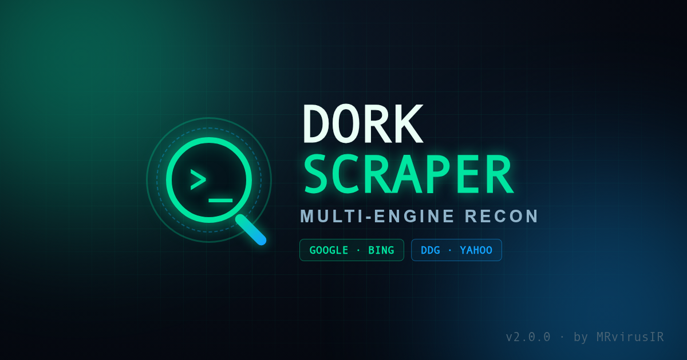

<p align="center">
  
</p>

<h1 align="center">
   Dork-Scraper
</h1>

<p align="center">
  <b>Fast, multi-engine Google-Dork URL scraper for recon &amp; bug bounty.</b><br>
  Search Google, Bing, DuckDuckGo &amp; Yahoo — then clean, filter and export the results.
</p>

<p align="center">
  
  
  
  
  <a href="https://t.me/BugCod3"></a>
</p>

---

## ✨ What's new in 2.0

Dork-Scraper was rewritten from the ground up. The old single-file Selenium script is now a clean, installable Python package:

- 🔎 **4 search engines** — `google`, `bing`, `duckduckgo`, `yahoo`
- ⚡ **Lightweight by default** — plain HTTP requests (no browser needed); Selenium optional
- 📂 **Batch mode** — run dozens of dorks from a file, with ready-made dork lists included
- 🧹 **Built-in cleaning** — dedupe, strip tracking params, drop static assets, keep only parameterised URLs
- 🌐 **Domain filters** — include/exclude by glob (`*.gov`, `*.example.com`, …)
- 💾 **Export** — `txt`, `json` or `csv`
- 🥷 **Stealth** — rotating User-Agents, randomised delays, retries w/ backoff, proxy support, CAPTCHA detection
- 🎨 **Pretty terminal output** with `rich` (auto-falls back to plain text)
- ✅ Unit tests + GitHub Actions CI

> See the full list in [CHANGELOG.md](CHANGELOG.md).

---

## 📦 Installation

```bash
git clone https://github.com/MRvirusIR/Dork-Scraper.git
cd Dork-Scraper
pip3 install -r requirements.txt
```

Or install as a command-line tool (adds the `dork-scraper` command):

```bash
pip3 install .
# with the optional Selenium engine:
pip3 install ".[selenium]"
```

---

## 🚀 Usage

```bash
# simplest: one dork, save to urls.txt
dork-scraper -d 'inurl:index.php?id='

# equivalent without installing:
python3 -m dorkscraper -d 'inurl:index.php?id='
```

### Common examples

```bash
# 3 pages from Google, JSON output
dork-scraper -d 'inurl:index.php?id=' -e google -p 3 -f json -o results.json

# run a whole list of dorks, keep only URLs with parameters, dedupe by pattern
dork-scraper -D dorks/sqli.txt --params-only --unique pattern -o targets.txt

# DuckDuckGo (no CAPTCHAs), limit to one target domain
dork-scraper -d 'site:example.com login' -e duckduckgo --include-domain '*.example.com'

# route everything through Burp / a proxy
dork-scraper -d 'ext:env DB_PASSWORD' --proxy http://127.0.0.1:8080

# use a real Chrome browser when an engine blocks HTTP requests
dork-scraper -d 'inurl:admin' --selenium

# clean an existing URL list (replaces the old split.py + clean-urls.py)
dork-scraper --clean-file old_urls.txt --drop-static --unique domain -o clean.txt
```

---

## ⚙️ Options

| Flag | Description |
|------|-------------|
| `-d, --dork` | A dork query (repeatable) |
| `-D, --dork-file` | File with one dork per line (`#` = comment) |
| `-e, --engine` | `google` \| `bing` \| `duckduckgo` \| `yahoo` (default `google`) |
| `-p, --pages` | Result pages per dork (default `1`) |
| `-o, --output` | Output file (default `urls.txt`) |
| `-f, --format` | `txt` \| `json` \| `csv` |
| `--unique` | De-dupe mode: `exact` \| `domain` \| `pattern` \| `none` |
| `--params-only` | Keep only URLs with query parameters |
| `--drop-static` | Drop images / css / fonts / media |
| `--trailing-slash` | Append `/` to param-less paths |
| `--keep-tracking` | Keep `utm_*` / `gclid` / … tracking params |
| `--include-domain` / `--exclude-domain` | Domain glob filters (repeatable) |
| `--clean-file` | Clean an existing URL file without scraping |
| `--delay` / `--jitter` | Base + random delay between requests |
| `--timeout` / `--retries` | Request timeout & retry count |
| `--proxy` | Proxy URL, e.g. `http://127.0.0.1:8080`, `socks5://…` |
| `--selenium` / `--no-headless` | Use a real Chrome browser |
| `-q, --quiet` / `--no-banner` | Quieter output |

Run `dork-scraper -h` for the complete list.

### `--unique` modes

| Mode | Keeps |
|------|-------|
| `exact` | Every distinct URL (default) |
| `domain` | One URL per domain |
| `pattern` | One URL per `host + path + parameter-names` — ideal for SQLi/XSS target lists |
| `none` | No de-duplication |

---

## 📁 Included dork lists

Ready-to-use starter lists live in [`dorks/`](dorks):

- `sqli.txt` — common parameterised endpoints
- `exposed-files.txt` — leaked config / backup / log files
- `admin-panels.txt` — login & admin panels

```bash
dork-scraper -D dorks/exposed-files.txt -e bing -f csv -o findings.csv
```

---

## 🐍 Use as a library

```python
from dorkscraper import DorkScraper

with DorkScraper(engine="duckduckgo", pages=2, clean_opts={"params_only": True}) as s:
    result = s.scrape("inurl:index.php?id=")
    print(result.count, "URLs")
    for url in result.urls:
        print(url)
```

---

## 🤝 Contributing

Issues and PRs are welcome. Run the tests with:

```bash
pip install pytest
pytest -q
```

---

## ⚠️ Disclaimer

This tool is intended **only** for legal, authorised security testing, research and
educational purposes. You are solely responsible for how you use it. Scrape responsibly,
respect each search engine's Terms of Service and `robots.txt`, and only test systems you
have explicit permission to assess. The author assumes no liability for misuse.

---

## 📜 License

Released under the [MIT License](LICENSE).

## 💜 Donate / Contact

Join the channel: **[t.me/BugCod3](https://t.me/BugCod3)** &lt;3
